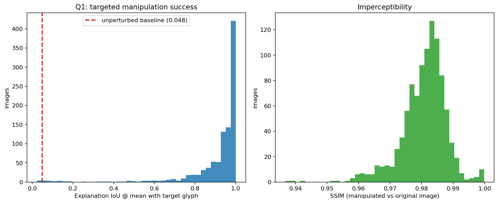
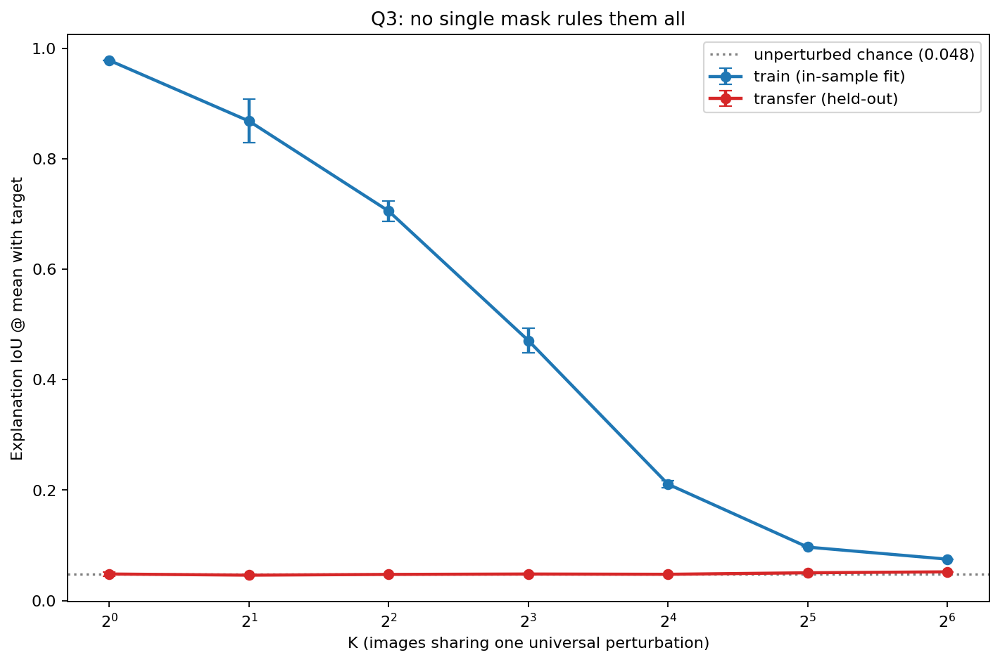

# MIMexplain: faking Grad-ECLIP explanations of MetaCLIP-2

Explanation heatmaps are often read as evidence of what a vision-language model looked at.
This project tests how far that evidence can be trusted. For each image it optimizes a
small, bounded pixel perturbation that makes the Grad-ECLIP explanation of MetaCLIP-2
(ViT-B/16) draw a chosen target, the glyph "2+2=5", while the image and the model's
prediction stay nearly unchanged. It then asks whether one shared perturbation can do the
same on images it has never seen.

## Key results

Per-image attack on 1000 Pexels photos, 2000 optimization steps each. Values are medians
over the images, from `saved/harvest/summary.json`.

| Metric | Median |
|---|---|
| Explanation IoU with the target, original image | 0.046 |
| Explanation IoU with the target, attacked image | 0.957 |
| SSIM, attacked vs original image | 0.982 |
| PSNR, attacked vs original image | 44.2 dB |
| Largest per-pixel change (L-inf, pixel values in [0, 1]) | 0.076 |
| Cosine similarity of the image embedding, before vs after | 0.984 |

IoU is measured between the explanation thresholded at its mean and the target mask. The
top-1 label, over a vocabulary of ImageNet classes plus the image's own caption, is
unchanged for 95.2% of images.



The explanation can be redrawn almost at will while the image and the prediction barely
move, so on this model a Grad-ECLIP map is weak evidence of what drove the prediction.

The attack does not transfer, though. A single perturbation shared across K training
images fits them only while K is small, and on 50 held-out images the IoU stays at the
unperturbed level of about 0.05 for every K from 1 to 64. The sweep has two seeds for K up
to 16 and one seed for K = 32 and 64.



## Approach

- **Explanation.** Grad-ECLIP on `facebook/metaclip-2-worldwide-b16`. Images are fed at
  512x512 instead of the native 224x224, with interpolated position embeddings, which
  gives a 32x32 explanation grid; 14x14 is too coarse to draw the glyph. The last vision
  layer and the last 8 text layers are rebuilt from their q/k/v projections so the
  tensors Grad-ECLIP needs stay in the autograd graph.
- **Attack.** Adam updates a perturbation for 2000 steps. Its per-pixel cap is 30/255,
  raised up to 2.5 times where a perceptual map (local variance, gradients, structure and
  saliency) says a change is less visible. The loss combines the distance between the
  explanation and the target (with extra weight on glyph cells), L1, L2 and L-inf
  penalties on the perturbation, a cosine term that keeps the image embedding close to the
  original, and a KL term between the original and attacked prediction distributions over
  200 ImageNet prompts. Grad-ECLIP is itself a gradient, computed with
  `create_graph=True`, so the optimizer differentiates through the explanation (a
  second-order objective).
- **Data.** 1000 images sampled at random from the Kaggle Pexels-110k-512p dataset, each
  with the prompt "Photo of {title}" from the dataset labels. The download script reads
  only the sampled files from the remote archive using HTTP range requests.
- **Transfer test.** One perturbation with a uniform budget is trained jointly on K images,
  then applied unchanged to those images and to 50 held-out images.

## How to run

```bash
uv sync
uv run pytest                    # fast tests; add -m slow to download MetaCLIP-2 and run real inference
uv run mimexplain --example winter-bench --output-dir outputs/demo   # Grad-ECLIP map for a bundled image
```

Reproducing the experiments (a GPU is recommended; the download needs Kaggle credentials):

```bash
uv run python scripts/download_pexels_subset.py --num 1000           # writes data/pexels-1k
uv run python scripts/run_hubert_2plus2eq5_manipulation.py          # per-image attack, outputs/manipulation1
uv run python scripts/run_universal_mask_transfer.py                # K sweep, outputs/universal_mask_transfer
uv run python scripts/harvest_manipulation_results.py \
    --input-dir outputs/manipulation1 \
    --universal-summary outputs/universal_mask_transfer/results_summary.json \
    --output-dir outputs/harvest
```

## Repository layout

```
explainer/                       Grad-ECLIP on MetaCLIP-2 (gradeclip.py, metaclip2.py) and the CLI
explainer/manipulation/          per-image and shared-perturbation attacks, target masks, perceptual budget
scripts/                         experiment drivers, result aggregation, visualization, data download
saved/harvest/                   per-image results of the 1000-image run, summary and figures
saved/universal_mask_transfer/   transfer sweep results per seed, per image and per training step
assets/examples/                 images used by the tests and the CLI demo
tests/                           unit tests; tests that load the real model are marked slow
```

## References

- [MetaCLIP-2 model card](https://huggingface.co/facebook/metaclip-2-worldwide-b16)
- [Grad-ECLIP paper](https://arxiv.org/abs/2502.18816) and [reference code](https://github.com/Cyang-Zhao/Grad-EClip)
- [Pexels-110k-512p dataset](https://www.kaggle.com/datasets/innominate817/pexels-110k-512p-min-jpg/data)
- `assets/examples/example_winter_bench.jpg`: photo by Dominicus Johannes Bergsma, [CC BY-SA 4.0](https://creativecommons.org/licenses/by-sa/4.0/), via [Wikimedia Commons](https://commons.wikimedia.org/wiki/User:Famberhorst)

## Authors

Hubert Michalski and Przemysław Fuchs. Course project at the University of Warsaw (MSc
Machine Learning), 2026.
